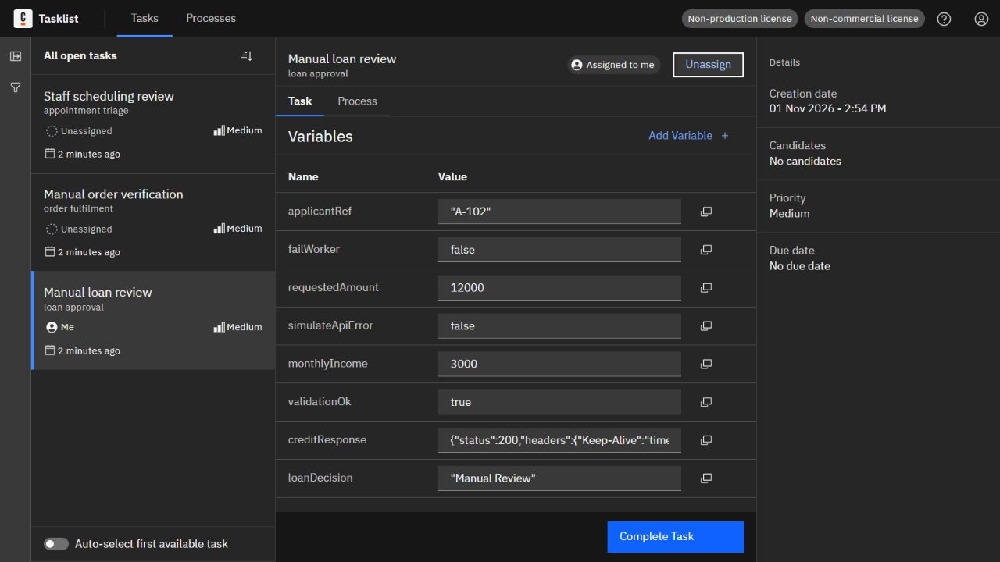
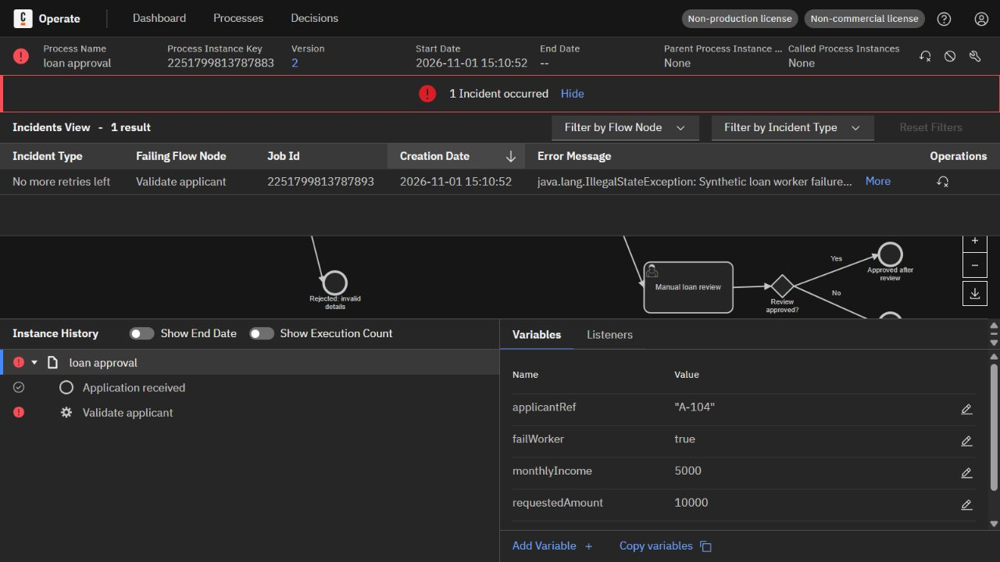
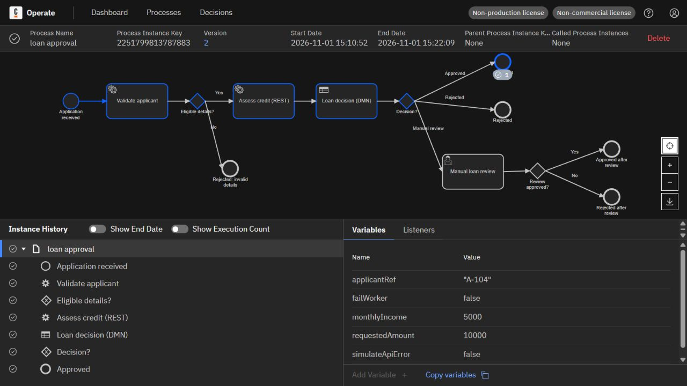
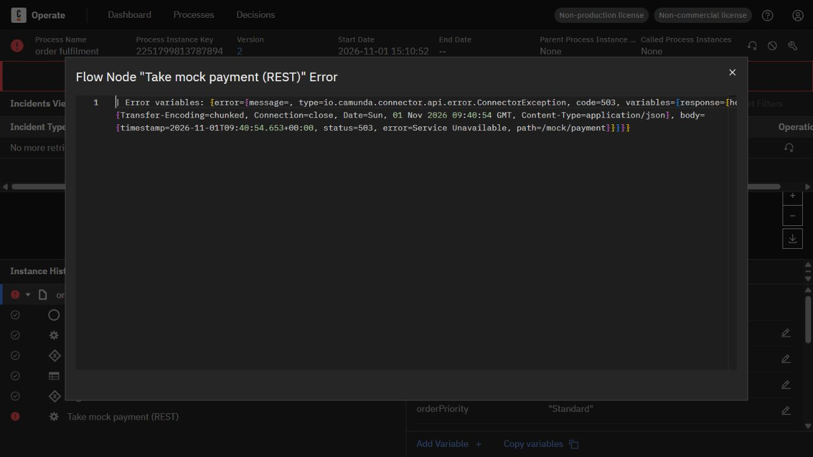
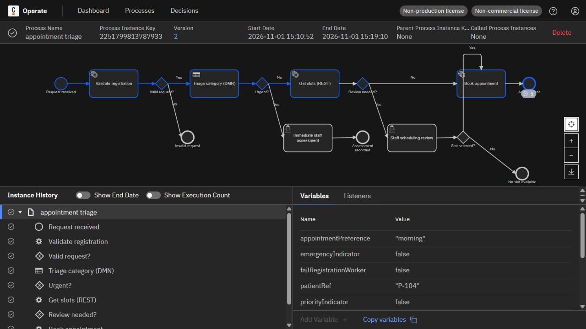

# Actual execution and screenshot evidence

All images below show the student's running local Camunda 8 Run 8.8.32 implementation on 1 November 2026. They are genuine application captures. The completed-instance PNGs were supplied by the student; the Tasklist, incident, and recovery JPEGs were captured directly during fresh runs. Model design renderings are kept separately in each lab folder.

## Required screenshots by lab

| Lab | Normal completion | Assigned human review | Incident investigation | Same instance after recovery |
|---|---|---|---|---|
| Loan | [Approved](screenshots/lab1_loan_completed.png) | [Manual loan review](screenshots/lab1_tasklist_review.jpg) | [Worker failure](screenshots/lab1_worker_incident.jpg) | [Approved after retry](screenshots/lab1_worker_recovered.jpg) |
| Order | [Order fulfilled](screenshots/lab2_order_completed.png) | [Manual order verification](screenshots/lab2_tasklist_review.jpg) | [Payment failure](screenshots/lab2_payment_incident.jpg) | [Fulfilled after retry](screenshots/lab2_payment_recovered.jpg) |
| Appointment | [Appointment booked](screenshots/lab3_appointment_completed.png) | [Staff scheduling review](screenshots/lab3_tasklist_review.jpg) | [Scheduling failure](screenshots/lab3_scheduling_incident.jpg) | [Booked after retry](screenshots/lab3_scheduling_recovered.jpg) |

Additional diagnosis views: [payment failed route](screenshots/lab2_payment_failed_path.jpg), [payment HTTP 503 details](screenshots/lab2_payment_error_details.jpg), [scheduling failed route](screenshots/lab3_scheduling_failed_path.jpg), and [scheduling HTTP 503 details](screenshots/lab3_scheduling_error_details.jpg).

## Traceability

| Lab | Original normal instance | Tasklist review process instance | Task key | Final incident and recovery process instance |
|---|---|---|---|---|
| Loan | 2251799813770184 | 2251799813784665 | 2251799813784700 | 2251799813787883 |
| Order | 2251799813770243 | 2251799813784713 | 2251799813784764 | 2251799813787894 |
| Appointment | 2251799813770208 | 2251799813784785 | 2251799813784842 | 2251799813787933 |

Each review task was assigned to the local demo reviewer and completed through Tasklist. Loan and order reviews used `reviewApproved=true`; scheduling review used `slotSelected=true` with the existing synthetic selected slot.

The loan failure was caused by `failWorker=true`. The two REST failures were caused by synthetic `simulateError=true` requests, producing HTTP 503. For the final captures, faults were corrected using the local variable API, and Retry was selected in the Operate UI. Root failure flags were set false, and the REST tasks' copied `body.simulateError` fields were also set false. Recovery screenshots show the same instance keys completed with no active incident.

## Saved records

- `run_results.csv` and `.json`: original 16 synthetic tests, all completed as expected.
- `screenshot_run_results.csv` and `.json`: nine additional demonstration runs, all completed. Initial failure captures were replaced because the side panel clipped important details; the final three failure instances above provide the readable incident/recovery pairs.
- `screenshot_run_keys.json`: six initial demonstration instance keys.
- `final_capture_failure_keys.json`: three final full-width incident/recovery instance keys.
- `incident_*.json`: four active incident responses preserved from the original test suite.
- `screenshot_incident_*.json`: active incident responses preserved during screenshot demonstrations. Each final failure instance has its own saved incident record.

The original 16-test suite completed human tasks through the local user-task API. The later three review demonstrations used the Tasklist UI. No placeholder or generated UI screenshots are included.

## Preview

