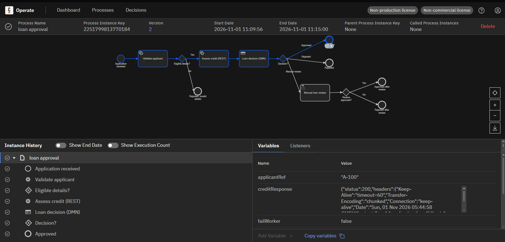
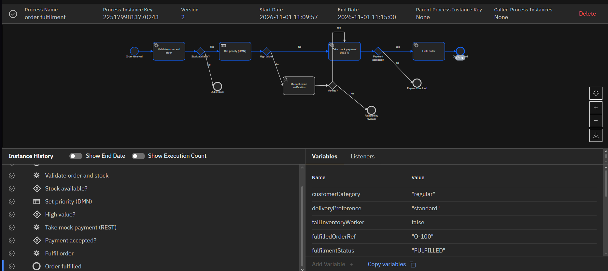
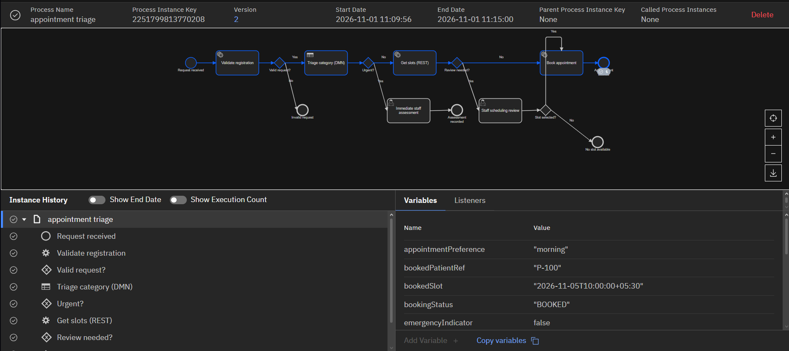

# Evidence index

These screenshots were supplied from the student's running Camunda implementation on 1 November 2026. They show version 2 instances, execution routes, history, and variables. They are genuine application captures, not generated UI images.

| Evidence | Instance key | Screenshot |
|---|---|---|
| Loan approved | 2251799813770184 | [Loan completion](screenshots/lab1_loan_completed.png) |
| Order fulfilled | 2251799813770243 | [Order completion](screenshots/lab2_order_completed.png) |
| Appointment booked | 2251799813770208 | [Appointment completion](screenshots/lab3_appointment_completed.png) |

`run_results.csv` and `run_results.json` record the actual final state of 16 synthetic instances. Four `incident_*.json` files preserve API responses captured while intentional faults were active. They support diagnosis but do not replace the required Operate screenshots. The loan API failure was also observed and recovered; its active incident response was not saved separately.

## Outstanding captures

Each lab still needs a waiting human task shown in Tasklist, an intentional service/worker incident shown in Operate, and the completed instance after that incident is corrected and retried. These screenshots are absent; no placeholder files are used. See [capture instructions](../EVIDENCE_TO_CAPTURE.md).

Human review test tasks in the recorded runs were completed using the local Camunda user-task API. The Tasklist UI evidence must still be captured during fresh review runs.
